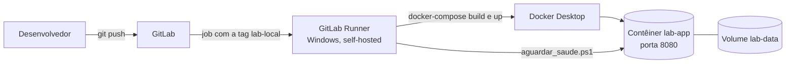

# docker-gitlab-ci-lab

Laboratório de DevOps: uma aplicação web mínima em Flask, empacotada com Docker e implantada automaticamente por um pipeline do GitLab CI/CD, usando um **runner self-hosted no Windows**. A cada `git push` na branch principal, o runner constrói a imagem, recria o contêiner e só aprova o deploy quando o healthcheck responde.

> **English summary:** a minimal Flask app packaged with Docker/Docker Compose and deployed by a GitLab CI/CD pipeline on a self-hosted Windows runner (build, recreate container, wait for the healthcheck). The `docs/troubleshooting.md` file documents the real failures hit while building it (service PATH, Docker CLI plugins, runner shell, port binding, firewall) and their root causes.

O objetivo do projeto é **aprender e documentar o caminho completo**: do código ao deploy automático, incluindo os erros reais que apareceram no caminho e como cada um foi diagnosticado.

## Arquitetura



## Stack

- Python 3.12 e Flask, servido pelo Gunicorn
- Docker e Docker Compose
- GitLab CI/CD com GitLab Runner (executor `shell`, Windows)
- PowerShell (script de verificação de saúde)

## Estrutura do repositório

```
.
├─ app.py                       # API mínima (health e contador persistente)
├─ requirements.txt
├─ Dockerfile                   # imagem: usuário sem root, healthcheck, Gunicorn
├─ docker-compose.yml           # porta, volume, variáveis, healthcheck
├─ .gitlab-ci.yml               # pipeline de deploy
├─ scripts/
│  └─ aguardar_saude.ps1        # espera o contêiner ficar healthy
├─ docs/
│  └─ troubleshooting.md        # falhas reais, causa e solução
├─ .gitignore  .dockerignore
└─ LICENSE
```

## Endpoints

| Método | Rota | Descrição |
|---|---|---|
| GET | `/` | Nome do app e versão em execução (o commit que gerou o deploy) |
| GET | `/api/health` | Usado pelo healthcheck do Docker |
| GET | `/api/visits` | Lê o contador de visitas |
| POST | `/api/visits` | Incrementa o contador e grava em arquivo no volume |

O contador existe para provar que os dados **sobrevivem à recriação do contêiner** (volume `lab-data`).

## Como rodar localmente

Pré-requisitos: Git e Docker Desktop.

```powershell
git clone https://github.com/Osouzaal/docker-gitlab-ci-lab.git
cd docker-gitlab-ci-lab
docker compose up -d --build
docker compose ps                      # o serviço deve aparecer como healthy
```

Testando:

```powershell
Invoke-RestMethod http://localhost:8080/api/health
Invoke-RestMethod -Method Post http://localhost:8080/api/visits
Invoke-RestMethod http://localhost:8080/api/visits
```

Testando a persistência:

```powershell
docker compose down                    # sem -v: o volume é preservado
docker compose up -d
Invoke-RestMethod http://localhost:8080/api/visits   # o contador continua igual
```

## Como o pipeline funciona

O arquivo `.gitlab-ci.yml` define um único job, `deploy`, executado por um runner com a tag `lab-local`:

1. `docker-compose build`: constrói a imagem (a variável `APP_VERSION` recebe o hash do commit).
2. `docker-compose up -d --remove-orphans`: recria o contêiner com a imagem nova.
3. `scripts/aguardar_saude.ps1`: consulta o status de saúde do contêiner por até 90 segundos. Se não ficar `healthy`, imprime os logs e reprova o pipeline.
4. `docker image prune -f`: remove imagens antigas sem uso.

Depois de cada deploy, `GET /` mostra o hash do commit em execução.

### Preparando o runner (resumo)

1. No projeto do GitLab, crie um *project runner* com a tag `lab-local` e registre-o no PC (`gitlab-runner.exe register`, executor `shell`).
2. No `config.toml`, defina `shell = "powershell"` e um `environment` com o `PATH` que inclua as pastas do Git e do Docker.
3. Instale e inicie o serviço (`gitlab-runner.exe install` e `start`).

Cada um desses passos tem uma armadilha conhecida. Elas estão explicadas em [`docs/troubleshooting.md`](docs/troubleshooting.md).

## Decisões técnicas

- **Gunicorn em vez do servidor do Flask:** o `app.run` é um servidor de desenvolvimento. O Gunicorn é um servidor WSGI de produção.
- **1 worker com 4 threads:** o contador é um arquivo JSON, sem controle de concorrência entre processos. Um único processo evita corrupção; as threads compartilham um `lock`.
- **Escrita atômica:** o app grava num arquivo temporário e troca com `os.replace`, para nunca deixar o arquivo pela metade.
- **Usuário sem privilégios:** o contêiner não roda como root.
- **Camadas em cache:** o `requirements.txt` é copiado e instalado antes do código, então rebuilds só reinstalam dependências quando elas mudam.
- **Healthcheck e espera no pipeline:** "contêiner iniciado" não significa "aplicação respondendo". O deploy só passa quando o app responde de fato.
- **Volume nomeado:** os dados ficam fora do contêiner descartável.
- **Porta presa em `127.0.0.1`:** nada fica exposto na rede por padrão.

## Problemas encontrados e como foram resolvidos

Os mais instrutivos (detalhes e causa raiz em [`docs/troubleshooting.md`](docs/troubleshooting.md)):

- O job ficava pendente: tag, vínculo do runner com o projeto e a opção *protected*.
- `exec: "pwsh" not found`: o runner usava o PowerShell Core, que não estava instalado.
- `docker` não encontrado no job, mas funcionando no terminal: o serviço do runner roda como conta de sistema e não enxerga o `PATH` do usuário.
- `docker compose` não existia para o runner: o plugin do CLI não estava no `PATH` do serviço; o executável `docker-compose` funcionou.
- `powershell` não encontrado depois de ajustar o `PATH`: a variável `environment` substitui o `PATH`, e o `powershell.exe` fica numa subpasta (`WindowsPowerShell\v1.0`).
- Ping funcionando e porta fechada: a publicação da porta estava presa em `127.0.0.1`.

## Segurança

- Nenhum segredo, token ou dado real faz parte do repositório. O `.gitignore` bloqueia `.env`, `config.toml` e os arquivos de dados.
- O token do runner (`glrt-...`) deve ser tratado como senha. Se ele aparecer em qualquer lugar público, redefina-o.
- Quem tem permissão de escrita no repositório pode alterar o `.gitlab-ci.yml` e, com isso, executar comandos no computador do runner. Conceda acesso só a quem você confia.

## Próximos passos

- Acesso remoto privado com HTTPS usando `tailscale serve`, mantendo a porta presa em `127.0.0.1`.
- Testes automatizados (`pytest`) em um estágio anterior ao deploy.
- Publicar a imagem em um registry em vez de construir sempre localmente.
- Variante do pipeline para um runner Linux, usando `docker compose` com espaço.

## Autor

**Iverson Souza Gomes**

- GitHub: [github.com/Osouzaal](https://github.com/Osouzaal)
- LinkedIn: [linkedin.com/in/iverson-souza-b9a40b157](https://www.linkedin.com/in/iverson-souza-b9a40b157)

Licença: [MIT](LICENSE).
